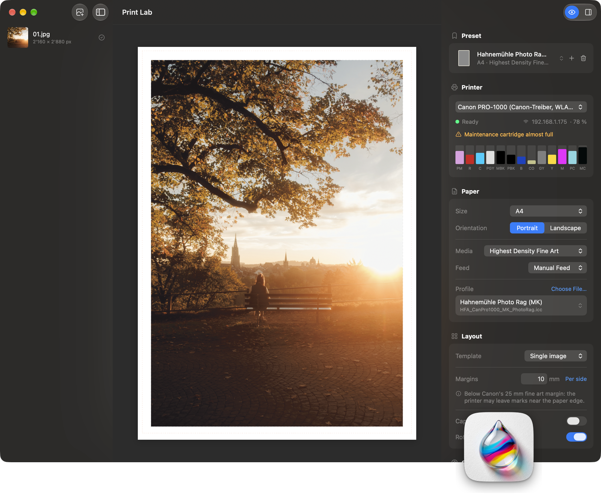

# Print Lab

A macOS app for printing photos on Canon photo printers. An open alternative to Canon's Professional Print & Layout.



- **Layouts:** one image per sheet, grids, contact sheets with captions. Drag to move the crop, drop images onto cells.
- **Color:** 16-bit conversion into the paper profile, softproof with paper white. Canon's profiles per media type, or the paper maker's own (e.g. Tecco, Hahnemühle).
- **Printing:** straight to Canon's driver with the right media type, quality and margins. The driver's rules apply, e.g. no borderless on plain paper.
- **Printer status:** ink levels, Wi-Fi signal, maintenance cartridge, and errors with Canon's support code and help link.
- **Remote control:** scripts can set up a sheet via `printlab://`. Printing stays a button press.

Print Lab is not affiliated with Canon.

## Install

```
brew install yannickpulver/tap/print-lab
```

Print Lab needs Canon's IJ driver for your printer and the printer added in System Settings → Printers & Scanners.

Besides the PRO-1000, other Canon printers with the IJ driver (e.g. PRO-300, PRO-200) show up and get paper sizes, media types, quality, margins and Canon's paper profiles from their own driver.

## How colors flow

```
Image (16 bit, own profile)
  → app: convert into the paper profile (ColorSync, chosen intent, black point compensation)
  → PDF, pixel values tagged as sRGB
  → macOS: sRGB → sRGB, values unchanged
  → Canon driver: "No Color Correction" (CNIJIntent2=1001), RGB16
  → printer
```

The app does the only color conversion. `PrintPipelineTests` proves this without paper: it runs the app's PDF through macOS's `cgpdftoraster` with the driver options and compares the raster pixels with the values the app computed.

## Remote control

Scripts (or an agent) can set up a sheet. Printing stays a button press in the app.

```
open "printlab://configure?clear=1&paper=A3&media=Baryta&quality=Super%20Fine&template=grid&rows=1&columns=2&margins=20&image=/path/a.tif&image=/path/b.tif"
cat ~/Library/Application\ Support/PrintLab/state.json
```

`state.json` holds the current settings, cells with print resolution, driver conflicts, printer status, all valid option values and the errors of the last command. The keys are listed in `RemoteControl.swift`.

## Requirements

- macOS 26
- Canon IJ driver installed, with a CUPS queue that uses it (the app lists every queue whose PPD has `CNIJMediaType`)
- Xcode 27, [Tuist](https://tuist.dev)

## Build

```
tuist generate
xcodebuild -workspace PrintLab.xcworkspace -scheme PrintLab build
xcodebuild -workspace PrintLab.xcworkspace -scheme PrintLab test
```

## Release

The version lives in `VERSION`. Bump it and push to `main`:

```
push to main with a new VERSION
  → GitHub Actions: test, build, sign (Developer ID), notarize, release Print-Lab.zip + appcast.xml
  → homebrew-tap: Casks/print-lab.rb gets the new version and checksum
  → installed apps: Sparkle finds the update via the appcast
```

A version that is already released is not built again.

The release needs GitHub secrets for signing, notarization, Sparkle and the tap. `scripts/setup-release-secrets.sh` walks through them once and checks each value.

## Layout

| Folder | Content |
| --- | --- |
| `App/Sources/Printer` | PPD reader, Canon driver options, CUPS queues, IPP status, job submission |
| `App/Sources/Color` | Image loading, ColorSync conversion, softproof |
| `App/Sources/Layout` | Sheet model, templates (single, grid, contact sheet) |
| `App/Sources/Print` | Shared drawing for preview and PDF, print job |
| `App/Sources/UI` | SwiftUI views |

## Tested on

- Canon imagePROGRAF PRO-1000 over Wi-Fi, macOS 27

## License

MIT
